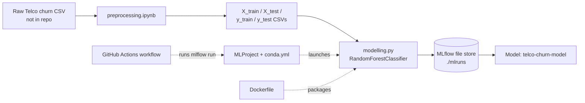

# Telco Customer Churn MLOps

A small end-to-end machine-learning project that predicts whether a telecom customer will churn. It covers data preparation in a notebook, model training with a scikit-learn Random Forest, experiment tracking and model registration with MLflow, an MLflow Project definition, a Dockerfile, and a GitHub Actions workflow for retraining.

## Table of Contents

- [Overview](#overview)
- [Features](#features)
- [Technology Stack](#technology-stack)
- [System Architecture](#system-architecture)
- [Repository Structure](#repository-structure)
- [Prerequisites](#prerequisites)
- [Installation and Setup](#installation-and-setup)
- [Configuration](#configuration)
- [How to Run](#how-to-run)
- [Usage Guide](#usage-guide)
- [Data](#data)
- [Model Training and Evaluation](#model-training-and-evaluation)
- [Experiment Tracking and Model Registry](#experiment-tracking-and-model-registry)
- [CI/CD](#cicd)
- [Docker](#docker)
- [Testing](#testing)
- [Troubleshooting](#troubleshooting)
- [Security and Limitations](#security-and-limitations)
- [Future Improvements](#future-improvements)
- [Contributing](#contributing)

## Overview

**Problem:** customer churn (customers leaving a service) is costly for telecom companies. This project builds a binary classifier that estimates, from 19 customer attributes such as contract type, tenure, services subscribed, and charges, whether a customer is likely to churn (`1`) or stay (`0`).

**Intended users:** students and practitioners learning an MLOps workflow: preprocessing, training, experiment tracking, packaging, and automated retraining.

**What is implemented:**

- A preprocessing notebook that cleans, encodes, scales, and splits the data into four CSV files.
- A training script (`modelling.py`) that fits a Random Forest and logs the run to a local MLflow file store.
- An MLflow Project definition (`MLProject`) with a conda environment file.
- A Dockerfile and a GitHub Actions workflow definition.
- A committed MLflow tracking folder containing a recorded baseline run and a registered model named `telco-churn-model`.

## Features

| Feature | Description |
|---------|-------------|
| Data preprocessing notebook | Converts `TotalCharges` to numeric, fills its missing values with 0, drops `customerID` and duplicate rows, label-encodes categorical columns, maps `Churn` to 1/0, performs a stratified 80/20 train/test split, and standardizes three numeric columns. |
| Model training | Trains a `RandomForestClassifier` (100 trees, `max_depth=10`, `random_state=42`). |
| Test-set metrics | Prints accuracy, precision, recall, and F1 on the held-out test set. |
| MLflow autologging | `mlflow.sklearn.autolog()` records parameters, training metrics, plots (confusion matrix, ROC curve, precision-recall curve), and the fitted model. |
| MLflow Project | `MLProject` exposes a `main` entry point so training can be launched with `mlflow run`. |
| Containerization | A Dockerfile packages the training script on `python:3.11-slim`. |
| Automated retraining workflow | A GitHub Actions workflow runs the MLflow Project and uploads the tracking folder as an artifact. |

## Technology Stack

| Technology | Version (as pinned in the repo) | Purpose |
|------------|--------------------------------|---------|
| Python | 3.10 (conda env and CI), 3.11 (Docker image) | Language |
| scikit-learn | 1.4.2 | Random Forest model and metrics |
| pandas | 2.2.2 | Loading and manipulating CSV data |
| NumPy | 1.26.4 | Numerical support |
| MLflow | 2.14.1 | Experiment tracking, model logging, model registry, MLflow Projects |
| Jupyter / Google Colab | not pinned | Running the preprocessing notebook |
| matplotlib, seaborn | not pinned | Exploratory charts in the notebook |
| Docker | not pinned | Container image |
| GitHub Actions | `actions/checkout@v4`, `actions/setup-python@v5`, `actions/upload-artifact@v4` | CI workflow |

## System Architecture

The project is a linear pipeline. There is no running service: preprocessing produces files, training consumes them, and MLflow writes results to a local folder.



### Components

| Component | Responsibility |
|-----------|----------------|
| `ML/preprocessing/preprocessing.ipynb` | Exploratory analysis and preprocessing; writes the four CSV files. |
| `ML/preprocessing/*.csv` | Pre-split, pre-encoded, partly scaled training and test data. |
| `ML/modelling.py` | Loads the CSVs, trains the model, evaluates it, and logs to MLflow (tracking URI `file:./mlruns`, experiment `Telco_Customer_Churn`). |
| `ML/MLProject`, `ML/conda.yml` | Defines the MLflow Project name (`telco_churn_ci`), entry point, and conda environment. |
| `ML/Dockerfile`, `ML/requirements.txt` | Container build and pinned pip dependencies. |
| `ML/mlruns/` | Committed MLflow tracking data: recorded runs and a registered model. |
| `.github/workflows/ci.yml` | Retraining workflow definition. |

## Repository Structure

```text
telco-churn-mlops/
├── .github/
│   └── workflows/
│       └── ci.yml                  # GitHub Actions: "CI - Retrain Model (MLflow Project)"
└── ML/
    ├── modelling.py                # Training and evaluation script
    ├── MLProject                   # MLflow Project definition
    ├── conda.yml                   # Conda environment for the MLflow Project
    ├── requirements.txt            # Pinned pip dependencies
    ├── Dockerfile                  # Container image definition
    ├── DockerHub_link.md           # Link to the Docker Hub repository (in Indonesian)
    ├── preprocessing/
    │   ├── preprocessing.ipynb     # Data cleaning, encoding, scaling, splitting
    │   ├── X_train.csv             # 5,616 rows x 19 features
    │   ├── X_test.csv              # 1,405 rows x 19 features
    │   ├── y_train.csv             # 5,616 labels (column: Churn)
    │   └── y_test.csv              # 1,405 labels (column: Churn)
    └── mlruns/                     # Committed MLflow tracking store (runs, model registry)
```

## Prerequisites

- **Python 3.10 or newer.** The repo pins Python 3.10 for the conda environment and CI and 3.11 for Docker. A scratch run was verified on Python 3.12.3.
- **pip** (and optionally **conda**, which `mlflow run` uses by default).
- **setuptools below 81** (`pip install "setuptools<81"`). MLflow 2.14.1 imports `pkg_resources`, which newer setuptools releases no longer provide; `conda.yml` already pins `setuptools<81` for this reason.
- **Git** to clone the repository.
- Optional: **Docker** for the container; **Jupyter** or a **Google account** (Colab) to re-run the notebook.

## Installation and Setup

1. **Clone the repository**

   ```bash
   git clone https://github.com/vanessaserenina/telco-churn-mlops.git
   cd telco-churn-mlops/ML
   ```

2. **Create and activate a virtual environment**

   ```bash
   python -m venv .venv
   source .venv/bin/activate        # Windows: .venv\Scripts\activate
   ```

3. **Install dependencies**

   ```bash
   pip install -r requirements.txt
   pip install "setuptools<81"
   ```

4. **Place the data where the script expects it.** `modelling.py` reads from a folder named `Telco-Customer-Churn_preprocessing` in the directory you run it from. The repository ships the same four CSV files in `preprocessing/`, so copy that folder:

   ```bash
   cp -r preprocessing Telco-Customer-Churn_preprocessing
   # Windows PowerShell: Copy-Item -Recurse preprocessing Telco-Customer-Churn_preprocessing
   ```

No database or external service is required.

## Configuration

There are no environment variables or `.env` files for the training script. Settings live in the code and project files:

| Setting | Where | Value |
|---------|-------|-------|
| MLflow tracking URI | `modelling.py` | `file:./mlruns` (local folder next to where you run the script) |
| MLflow experiment name | `modelling.py` | `Telco_Customer_Churn` |
| Data folder name | `modelling.py` | `Telco-Customer-Churn_preprocessing` (relative to the working directory) |
| Model hyperparameters | `modelling.py` | `n_estimators=100`, `max_depth=10`, `random_state=42` |
| `data_dir` project parameter | `MLProject` | string, default `Telco-Customer-Churn_preprocessing` |
| `MLFLOW_ALLOW_FILE_STORE` | set in the CI workflow | `"true"` |

To change hyperparameters, edit the `RandomForestClassifier(...)` call in `modelling.py`.

## How to Run

### Option 1: run the script directly

From the `ML/` directory with the environment active and the data folder in place:

```bash
python modelling.py
```

Expected behavior: MLflow creates (or reuses) the `Telco_Customer_Churn` experiment, trains the model, and prints a four-line evaluation block. The console messages are written in Indonesian.

### Option 2: run as an MLflow Project

```bash
mlflow run . --env-manager=local -P data_dir=Telco-Customer-Churn_preprocessing
```

`--env-manager=local` uses your current Python environment instead of building the conda environment from `conda.yml`. Omit it to let MLflow create the conda environment (requires conda). The entry point runs `python modelling.py --data_dir {data_dir}`.

### View the results in the MLflow UI

```bash
mlflow ui --backend-store-uri ./mlruns
```

The script prints this same command when it finishes. By default, MLflow serves the UI at `http://127.0.0.1:5000`.

## Usage Guide

1. **(Optional) Regenerate the data.** Open `ML/preprocessing/preprocessing.ipynb`. The notebook is written for Google Colab: it mounts Google Drive and reads `/content/drive/MyDrive/Telco-Customer-Churn.csv`. To run it elsewhere, replace that cell with a local `pd.read_csv(...)` pointing at your copy of the raw Telco churn CSV (not included in this repo). The notebook also needs `matplotlib` and `seaborn`, which are not in `requirements.txt`.
2. **Train.** Run `python modelling.py` or the `mlflow run` command above.
3. **Inspect.** Launch `mlflow ui` and open the `Telco_Customer_Churn` experiment to see parameters, metrics, and the confusion-matrix, ROC, and precision-recall plots.
4. **Load a logged model.** Each run stores the model under its `artifacts/model` folder. After a run, you can load it with MLflow's standard API, replacing `<run_id>` with the ID shown in the UI:

   ```python
   import mlflow.sklearn
   model = mlflow.sklearn.load_model("runs:/<run_id>/model")
   ```

   Inputs must have the same 19 columns, encoding, and scaling as the training CSVs.

## Data

Files in `ML/preprocessing/` are already preprocessed:

| File | Shape | Notes |
|------|-------|-------|
| `X_train.csv` | 5,616 x 19 | Features, no missing values |
| `X_test.csv` | 1,405 x 19 | Features, no missing values |
| `y_train.csv` | 5,616 x 1 | Column `Churn`: 4,131 zeros, 1,485 ones |
| `y_test.csv` | 1,405 x 1 | Column `Churn`: 1,033 zeros, 372 ones |

**Feature columns (19):** `gender`, `SeniorCitizen`, `Partner`, `Dependents`, `tenure`, `PhoneService`, `MultipleLines`, `InternetService`, `OnlineSecurity`, `OnlineBackup`, `DeviceProtection`, `TechSupport`, `StreamingTV`, `StreamingMovies`, `Contract`, `PaperlessBilling`, `PaymentMethod`, `MonthlyCharges`, `TotalCharges`.

**Encoding:** categorical text columns are label-encoded to integers. `tenure`, `MonthlyCharges`, and `TotalCharges` are standardized (scaler fitted on the training split only), which is why they contain negative decimals.

**Target:** `Churn` (1 = churned, 0 = stayed). Roughly 26% of rows in both splits are churners.

> The datasets are customer records. If you substitute your own data, avoid committing personal information.

## Model Training and Evaluation

`modelling.py` trains a Random Forest (`n_estimators=100`, `max_depth=10`, `random_state=42`), predicts on the test set, and prints accuracy, precision, recall, and F1.

**Results from a scratch run** of this repository's code and data (Python 3.12.3, pinned library versions), with the data copied as described in setup:

| Metric (test set) | Value |
|-------------------|-------|
| Accuracy | 0.7915 |
| Precision | 0.6386 |
| Recall | 0.4892 |
| F1-score | 0.5540 |

Results should be reproducible because `random_state=42` is set, but values may vary slightly across library versions or platforms.

**Metrics recorded in the committed MLflow run** (`RandomForest_baseline`) are the training-set metrics produced by autologging:

| Metric | Value |
|--------|-------|
| `training_accuracy_score` | 0.8885 |
| `training_precision_score` | 0.8861 |
| `training_recall_score` | 0.8885 |
| `training_f1_score` | 0.8855 |
| `training_roc_auc` | 0.9620 |
| `training_log_loss` | 0.2735 |

Autologging records these `training_*` values; the test-set values above are printed to the console by the script. Compare training and test figures when judging generalization.

## Experiment Tracking and Model Registry

The committed `ML/mlruns/` folder contains:

- Experiment **`Telco_Customer_Churn`** with a run named **`RandomForest_baseline`**: parameters (for example `n_estimators`, `max_depth`, `random_state`), the metrics above, a confusion matrix, ROC curve and precision-recall curve (PNG), the pickled model (`model.pkl`, MLmodel metadata with a 19-column input signature), and environment files.
- A registered model **`telco-churn-model`** with **version 1**, pointing to that run's model.
- Experiment **`0` (Default)** with four runs recorded from `mlflow run` (entry point `main`, parameter `data_dir`).

Running the script again adds new runs to `./mlruns` in your working directory.

## CI/CD

`.github/workflows/ci.yml` defines the workflow **"CI - Retrain Model (MLflow Project)"**:

- **Triggers:** a push to `main` that changes files under `MLProject/**`, or a manual run (`workflow_dispatch`).
- **Steps:** check out the repo; set up Python 3.10; install `mlflow==2.14.1`, `scikit-learn==1.4.2`, `pandas==2.2.2`, `numpy==1.26.4`; run `mlflow run . --env-manager=local -P data_dir=Telco-Customer-Churn_preprocessing` in `./MLProject` with `MLFLOW_ALLOW_FILE_STORE=true`; upload `MLProject/mlruns` as an artifact named `mlruns`.

## Docker

`ML/Dockerfile`:

```dockerfile
FROM python:3.11-slim
WORKDIR /app
COPY requirements.txt .
RUN pip install --no-cache-dir -r requirements.txt
COPY . .
CMD ["python", "modelling.py"]
```

Build and run (not verified in this review, since Docker was not available):

```bash
cd ML
docker build -t telco-churn-model .
docker run --rm telco-churn-model
```

`ML/DockerHub_link.md` states that the built image is published at `https://hub.docker.com/r/vanessaserenina/telco-churn-model`; that link was not checked.

## Testing

The repository contains **no automated unit or integration tests**. Model quality is assessed only through the metrics described above. The following manual checks were performed in a scratch copy of the repository:

- `python modelling.py` completed and printed the evaluation block.
- `mlflow run . --env-manager=local -P data_dir=Telco-Customer-Churn_preprocessing` completed.

## Troubleshooting

| Symptom | Likely cause and fix |
|---------|----------------------|
| `ModuleNotFoundError: No module named 'pkg_resources'` on `import mlflow` | Install an older setuptools: `pip install "setuptools<81"`. |
| `FileNotFoundError` for `Telco-Customer-Churn_preprocessing/X_train.csv` | The data folder is missing from your working directory. Copy `preprocessing/` to `Telco-Customer-Churn_preprocessing/` (see setup) and run from the same directory. |
| `ModuleNotFoundError: No module named 'mlflow'` when using `mlflow run --env-manager=local` | The shell's `python` is not the environment where you installed the requirements. Activate the virtual environment first. |
| `mlflow run` tries to build a conda environment and fails | Install conda, or add `--env-manager=local`. |
| MLflow warns about the file store or `mlruns` | The project uses a local file store. Set `MLFLOW_ALLOW_FILE_STORE=true` as the CI workflow does. |
| `mlflow ui` shows no runs | Start it from the same directory as the run, or pass the right path to `--backend-store-uri`. |
| Notebook fails on `google.colab` | The notebook is written for Colab. Run it there, or replace the Drive-mount cell with a local file path. |
| Notebook fails on `import seaborn` or `matplotlib` | `pip install matplotlib seaborn jupyter`. |

## Security and Limitations

- **No secrets** are used by the code or workflow; no credentials are stored in the repo.
- Models are stored with `cloudpickle`/pickle. Only load models from sources you trust.
- This is a training pipeline only: there is **no prediction API, web app, or batch-scoring script**.
- Preprocessing lives in a notebook and the fitted encoders and scaler are not saved, so new raw data cannot be transformed identically without recreating them.
- Only one model type (Random Forest) and one set of hyperparameters are used; no hyperparameter search or cross-validation is implemented.
- The classes are imbalanced (about 26% churn) and recall on the test set is moderate, so the model will miss a substantial share of churners.
- The raw dataset is not included in the repository.
- Tracking is local only; no remote MLflow tracking server is configured.

## Future Improvements

These are suggestions, not existing features:

- Make the data folder and hyperparameters configurable through command-line arguments.
- Log test-set metrics to MLflow alongside the training metrics.
- Move preprocessing into a reusable script or scikit-learn `Pipeline` and save it with the model.
- Add cross-validation, hyperparameter tuning, and class-imbalance handling; compare against other models.
- Add unit tests and a data-validation step.
- Serve the model with an API (for example `mlflow models serve` or a small web service).
- Use a remote MLflow tracking server and model registry.
- Add a status badge for the CI workflow to this README.
- Add a `.gitignore` for generated `mlruns` data, and a license file (none is present).

## Contributing

1. Fork the repository and create a branch: `git checkout -b feature/short-description`.
2. Set up the environment as described above and make your change.
3. Re-run `python modelling.py` (and `mlflow run` if you changed `MLProject`) to confirm training still works.
4. Commit with a clear message and open a pull request describing the change and how you checked it.

## License

No license file is present in the repository.
